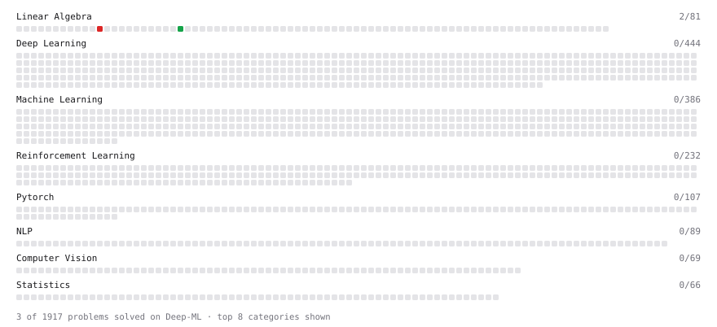

# Deep-ML

My machine learning practice from [Deep-ML](https://www.deep-ml.com). Every solution here was written by hand.

**6** solved · 4 problems · 0 labs · 2 math

[**Browse the interactive portfolio**](https://TextoT.github.io/deep-ml/) to replay this filling in over time.

## Problems

| | Difficulty | Solved | |
| --- | --- | --- | --- |
| [Gradient Direction and Magnitude](https://www.deep-ml.com/problems/308) | easy | 2026-11-05 | [solution](problems/0308-gradient-direction-and-magnitude) |
| [Implement Orthogonal Projection of a Vector onto a Line](https://www.deep-ml.com/problems/66) | easy | 2026-11-05 | [solution](problems/0066-implement-orthogonal-projection-of-a-vector-onto-a-line) |
| [Chain Rule for Composite Functions](https://www.deep-ml.com/problems/214) | medium | 2026-11-05 | [solution](problems/0214-chain-rule-for-composite-functions) |
| [Determinant of a 4x4 Matrix using Laplace's Expansion (hard)](https://www.deep-ml.com/problems/13) | hard | 2026-11-04 | [solution](problems/0013-determinant-of-a-4x4-matrix-using-laplace-s-expansion-hard) |

## Math

| | Difficulty | Solved | |
| --- | --- | --- | --- |
| [Determinants and Trace](https://www.deep-ml.com/math-problems/11) | medium | 2026-11-04 | [solution](math/0011-determinants-and-trace) |
| [Orthogonality and Projections](https://www.deep-ml.com/math-problems/14) | medium | 2026-11-05 | [solution](math/0014-orthogonality-and-projections) |

---

_This file is regenerated by Deep-ML on every push._
